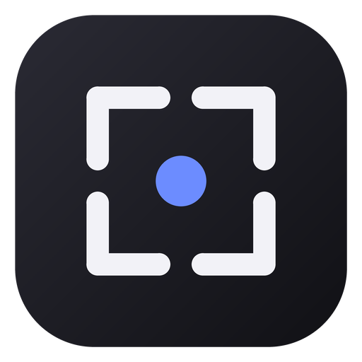

# Zenith Utility (ScreenText)

<p align="center">
  
</p>

<p align="center">
  <b>Современный, модульный и легковесный комплекс утилит для Windows 10 и 11</b><br>
  Повышайте продуктивность: распознавание текста с экрана (OCR), предпросмотр файлов Quick Look по клавише Пробел, закрепление окон поверх остальных, переназначение клавиш и умные подсказки.
</p>

<p align="center">
  <a href="README.md">English</a> •
  <b>Русский</b>
</p>

<p align="center">
  
  
  
  
  
</p>

---

## 📌 Оглавление

- [О проекте](#-о-проекте)
- [Ключевые возможности](#-ключевые-возможности)
  - [1. Скриншот области и оффлайн-OCR](#1-скриншот-области-и-оффлайн-ocr)
  - [2. Quick Look — мгновенный просмотр файлов](#2-quick-look--мгновенный-просмотр-файлов)
  - [3. Закрепление окон Always on Top (SnapZones)](#3-закрепление-окон-always-on-top-snapzones)
  - [4. Умные контекстные ссылки (SmartLinks)](#4-умные-контекстные-ссылки-smartlinks)
  - [5. Переназначение клавиш (Key Remap)](#5-переназначение-клавиш-key-remap)
- [Таблица горячих клавиш](#-таблица-горячих-клавиш)
- [Установка и Релизы](#-установка-и-релизы)
  - [Установщик Windows (Setup)](#установщик-windows-setup)
  - [Портативная версия (Portable)](#портативная-версия-portable)
  - [Системные требования](#системные-требования)
- [Архитектура и производительность](#-архитектура-и-производительность)
- [Сборка из исходного кода](#-сборка-из-исходного-кода)
- [Конфигурация и данные](#-конфигурация-и-данные)
- [Создание собственного модуля](#-создание-собственного-модуля)
- [Лицензия и благодарности](#-лицензия-и-благодарности)

---

## 💡 О проекте

**Zenith Utility** — это производительная модульная утилита для Windows, объединяющая самые востребованные инструменты для работы с контентом, окнами и файловой системой в одном элегантном решении. Приложение работает бесшумно в системном трее, потребляет минимальное количество оперативной памяти и выполняет все вычисления локально на вашем компьютере без облачных зависимостей.

### Главные преимущества

- ⚡ **Нулевые накладные расходы**: При выключении ненужных модулей их сервисы и фоновые перехватчики полностью освобождаются из памяти.
- 🎨 **Эстетика Windows 11**: Современный Fluent-интерфейс, поддержка материалов Mica и Acrylic, автоопределение темной и светлой темы.
- 🔒 **100% приватность**: Локальный Windows OCR и алгоритмы распознавания текста работают без подключения к сети.
- 🛡️ **Надёжность**: Защита от запуска повторных копий (Single-Instance Mutex + Named Pipe), перехват критических ошибок и аварийная отмена переназначения клавиш.

---

## ✨ Ключевые возможности

### 1. Скриншот области и оффлайн-OCR

Быстрое выделение любой области экрана с возможностью мгновенного распознавания текста и сканирования QR-кодов.

- **Горячие клавиши по умолчанию**:
  - `Ctrl + Shift + S` — создание скриншота выделенной зоны.
  - `Ctrl + Shift + T` — скриншот с оптическим распознаванием текста (OCR).
- **Встроенный Windows OCR**: Оффлайн-движок высокой точности распознает русский, английский и любые установленные в системе языковые пакеты.
- **Реконструкция верстки**: Сохраняет структуру абзацев, отступов и многоколоночного текста.
- **Сканер QR и штрихкодов**: Автоматически обнаруживает QR-коды в выделенной области и декодирует ссылки или текст.
- **Уведомления**: Интерактивные всплывающие тосты с кнопками быстрого копирования текста или открытия найденных URL.
- **Опциональное автосохранение**: Сохранение каждого снимка в выбранную папку в формате PNG.

### 2. Quick Look — мгновенный просмотр файлов

Аналог популярной функции macOS для Проводника Windows и Рабочего стола.

- **Активация**: Выделите любой файл в Проводнике и нажмите `Пробел` (`Space`). Нажмите `Space` или `Esc` снова для закрытия окна.
- **Поддерживаемые форматы**:
  - **Изображения**: `.png`, `.jpg`, `.jpeg`, `.webp`, `.bmp`, `.gif`, `.ico`, `.tiff`.
  - **Текст и код**: `.txt`, `.cs`, `.js`, `.ts`, `.json`, `.xml`, `.html`, `.css`, `.py`, `.md`, `.yaml`, `.log`, `.sql` и многие другие с подсветкой синтаксиса и нумерацией строк.
  - **PDF-документы**: Встроенный быстрый просмотр страниц PDF без запуска тяжелых сторонних программ.
  - **Медиа**: Видео и аудио (`.mp4`, `.mkv`, `.avi`, `.mp3`, `.wav`) со встроенным плеером.
- **Интеллектуальное позиционирование**: Окно просмотра открывается точно по центру экрана с адаптивным масштабом.

### 3. Закрепление окон Always on Top (SnapZones)

Закрепляйте любое активное окно поверх всех остальных окон Windows одним нажатием.

- **Горячая клавиша по умолчанию**: `Win + Ctrl + T`.
- **Визуальный индикатор**: Вокруг закрепленного окна отображается настраиваемая акцентная рамка, плавно следующая за перемещением и масштабированием окна.
- **Звуковое оповещение**: Приятный звуковой сигнал при закреплении и откреплении.
- **Список исключений**: Предотвращает случайное закрепление системных окон (`explorer.exe`, `SearchHost`, системные панели).

### 4. Умные контекстные ссылки (SmartLinks)

Интеллектуальный помощник для анализа данных из буфера обмена или распознанного текста.

- **Автоопределение сущностей**: Модуль распознает веб-ссылки, IP-адреса, Email, цветовые коды (HEX, RGB, HSL) и QR-коды.
- **Цветовая палитра**: Мгновенно отображает цвет в формате превью-чипа и позволяет скопировать значение в других форматах.
- **Генератор QR-кода**: Быстрая генерация QR-кода для любого текста или ссылки для передачи на смартфон.

### 5. Переназначение клавиш (Key Remap)

Низкоуровневый перехватчик клавиатуры (`WH_KEYBOARD_LL`) для переназначения клавиш и автоматизации ввода.

- **Гибкие правила**: Замена клавиш, вызов специальных символов, перенаправление служебных клавиш.
- **Аварийный сброс**: Удержание комбинации `Ctrl + Shift + Esc` в течение 1.5 секунд мгновенно приостанавливает работу перехватчика в случае зацикливания или блокировки клавиш.

---

## ⌨️ Таблица горячих клавиш

| Действие | Горячая клавиша | Настраивается | Описание |
| :--- | :---: | :---: | :--- |
| **Скриншот области** | <kbd>Ctrl</kbd> + <kbd>Shift</kbd> + <kbd>S</kbd> | Да | Выделение области и копирование картинки |
| **Скриншот + OCR** | <kbd>Ctrl</kbd> + <kbd>Shift</kbd> + <kbd>T</kbd> | Да | Распознавание текста и QR-кодов в буфер |
| **Quick Look** | <kbd>Space</kbd> | Да | Быстрый просмотр файла в Проводнике |
| **Закрепить окно (Top)** | <kbd>Win</kbd> + <kbd>Ctrl</kbd> + <kbd>T</kbd> | Да | Режим «Поверх всех окон» с цветной рамкой |
| **Аварийная остановка** | <kbd>Ctrl</kbd> + <kbd>Shift</kbd> + <kbd>Esc</kbd> | Да | Удержание 1.5 сек для сброса перехвата клавиш |
| **Окно настроек** | Два клика по иконке в трее | — | Открытие панели управления программой |

*Все горячие клавиши можно перенастроить в окне «Параметры» (`SettingsWindow`).*

---

## 📦 Установка и Релизы

Готовые сборки программы доступны в разделе [GitHub Releases](https://github.com/Orion-style/ScreenText/releases), а также в локальной папке репозитория [`Release/`](./Release/).

### Установщик Windows (Setup)

Официальный высококачественный инсталлятор `ZenithSetup-1.0.0-x64.exe` создан на базе Inno Setup:

- 🌐 **Двуязычный мастер**: Полная локализация на русский и английский языки.
- 👤 **Установка без прав администратора**: По умолчанию программа может быть установлена только для текущего пользователя в `%LocalAppData%\Programs\Zenith Utility` без появления запроса UAC, либо для всех пользователей системы (в `C:\Program Files\Zenith Utility`).
- 🖥️ **Ярлыки и автозагрузка**: Опции создания ярлыков на Рабочем столе и в меню «Пуск», а также добавления в автозапуск Windows.
- 🔄 **Автозакрытие перед обновлением**: Автоматически обнаруживает и безопасно закрывает запущенные экземпляры программы.
- 🧹 **Чистый деинсталлятор**: Полное удаление программы через «Параметры Windows» или «Панель управления» без оставления мусорных файлов.

#### Параметры тихой установки (для системных администраторов)

```powershell
# Тихая установка с ярлыком на Рабочем столе и добавлением в автозагрузку
.\ZenithSetup-1.0.0-x64.exe /VERYSILENT /SUPPRESSMSGBOXES /NORESTART /TASKS="desktopicon,autostart"
```

### Портативная версия (Portable)

Если вы не хотите устанавливать программу, используйте автономный исполняемый файл `ZenithApp.exe`. Он содержит все необходимые библиотеки .NET 8 и готов к работе без предварительной настройки: просто запустите его из любой папки или с USB-накопителя.

### Системные требования

- **Операционная система**: Windows 10 (версия 2004 / сборка 19041 или новее) / Windows 11.
- **Архитектура**: 64-бит (x64 / AMD64).
- **Среда выполнения**: .NET 8 Runtime (включена в комплект Self-Contained сборки; отдельная установка не требуется).

---

## 🏗️ Архитектура и производительность

Zenith спроектирован по модульному принципу:

```
ScreenText\
├── ZenithApp\                  # Основное WPF-приложение
│   ├── Core\                   # Общесистемные компоненты
│   │   ├── Hotkeys\            # Win32-регистрация глобальных хоткеев (HWND_MESSAGE)
│   │   ├── Lifecycle\          # SingleInstanceService (Named Mutex + Named Pipe)
│   │   ├── Logging\            # Легковесный файловый логгер с авторотацией
│   │   ├── Modules\            # BaseFeatureModule, ModuleManager (изоляция сбоев)
│   │   ├── Settings\           # Атомарное сохранение конфигурации в JSON
│   │   └── Startup\            # Управление автозапуском через системный реестр
│   ├── Modules\                # Изолированные плагины-модули
│   │   ├── Screenshot\         # Захват экрана, Windows OCR, парсер QR
│   │   ├── QuickLook\          # Просмотр файлов по Space, интеграция с Shell
│   │   ├── SnapZones\          # Закрепление окон поверх остальных
│   │   ├── SmartLinks\         # Контекстное всплывающее меню
│   │   └── KeyRemap\           # Низкоуровневый перехват клавиатуры
│   ├── Resources\              # Иконки, шрифты и словари строк
│   └── UI\                     # Views и ViewModels (WPF UI, Fluent Mica)
│
├── ZenithApp.Tests\            # Модульные и нагрузочные тесты (xUnit)
├── installer\                  # Скрипты сборщика инсталлятора Inno Setup
├── scripts\                    # Скрипты автоматизации CI/CD сборки
└── Release\                    # Скомпилированные дистрибутивы и контрольные суммы
```

### Принцип изоляции памяти (Zero-Cost Inactive Modules)
Каждый модуль наследует абстрактный класс `BaseFeatureModule`. Если модуль деактивирован пользователем в настройках:
1. Отписываются все глобальные перехватчики мыши и клавиатуры.
2. Закрываются все связанные графические оверлеи и скрытые окна.
3. Очищаются кэши и сборщик мусора освобождает неуправляемые дескрипторы.

---

## 🛠️ Сборка из исходного кода

### Необходимые инструменты

1. [.NET 8.0 SDK](https://dotnet.microsoft.com/download/dotnet/8.0)
2. [Inno Setup 6](https://jrsoftware.org/isdl.php) (для сборки `.exe`-инсталлятора)
3. Git

### Пошаговая сборка

```powershell
# 1. Клонирование репозитория
git clone https://github.com/Orion-style/ScreenText.git
cd ScreenText

# 2. Сборка проекта и запуск тестов
dotnet build ZenithApp.sln -c Release
dotnet test ZenithApp.sln -c Release

# 3. Публикация автономной (Self-Contained) версии
dotnet publish ZenithApp\ZenithApp.csproj -c Release -r win-x64 --self-contained true -p:PublishSingleFile=true -o build_output

# 4. Автоматическая сборка инсталлятора
powershell -ExecutionPolicy Bypass -File .\scripts\build-installer.ps1
```

После выполнения скрипта готовый установщик появится в директории `Release\ZenithSetup-1.0.0-x64.exe`.

---

## ⚙️ Конфигурация и данные

Конфигурационные файлы приложения хранятся в стандартном каталоге пользовательских данных Windows:

- **Файл настроек**: `%AppData%\ZenithApp\settings.json`
- **Журналы работы**: `%AppData%\ZenithApp\Logs\app-YYYYMMDD.log`

Настройки сохраняются атомарно через временный файл с резервным копированием, что полностью исключает повреждение данных при внезапном выключении питания.

---

## 🧩 Создание собственного модуля

Добавить новый функционал в Zenith предельно просто:

1. Создайте класс в папке `ZenithApp/Modules/YourModule/`, унаследованный от `BaseFeatureModule`:
   ```csharp
   public sealed class MyFeatureModule : BaseFeatureModule
   {
       public override string Id => "my_feature";
       public override string Name => "Мой крутой модуль";
       public override string Description => "Описание нового модуля.";

       public MyFeatureModule(IAppLogger logger) : base(logger) { }

       protected override Task OnEnableAsync()
       {
           Logger.LogInfo("Модуль активирован!");
           return Task.CompletedTask;
       }

       protected override Task OnDisableAsync()
       {
           Logger.LogInfo("Модуль деактивирован!");
           return Task.CompletedTask;
       }
   }
   ```
2. Зарегистрируйте его в `ConfigureServices` в `App.xaml.cs`:
   ```csharp
   services.AddSingleton<IFeatureModule, MyFeatureModule>();
   ```
3. Модуль мгновенно появится в окне «Параметры», получит управление переключателем и сохранение состояния в `settings.json`.

---

## 📄 Лицензия и благодарности

Проект распространяется под открытой лицензией [MIT](LICENSE).

### Используемые библиотеки
- [WPF-UI](https://github.com/lepoco/wpfui) — современные элементы управления в стиле Fluent Design для WPF.
- [ZXing.Net](https://github.com/micjahn/ZXing.Net) — библиотека распознавания и генерации штрихкодов и QR-кодов.
- [Microsoft.Windows.SDK.NET](https://github.com/microsoft/CsWinRT) — нативный доступ к API Windows 10/11 и Windows OCR.
